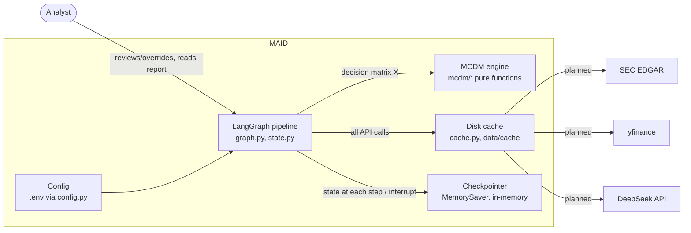

# MAID in an interview

One page to read before explaining the project. It adds no new claims: each answer summarizes a doc and links it.

## 2-minute pitch

The problem: rank about 12 companies in one sector on a mix of quantitative and qualitative criteria. The one idea
is that LLMs read filings and score them (1-9, each score with an evidence quote), while a deterministic MCDM engine
computes the weights and the ranking; the LLM never ranks ([D1](architecture/decisions.md)). The pipeline is a
LangGraph graph: ingest, scorer agents, a human-review interrupt, MCDM, robustness, report
([graph.md](architecture/graph.md)). The hard part is noise: at n=12, weight noise alone moves rankings (spike #6,
Kendall tau roughly 0.62 to 0.89, synthetic data only), so the report gives rank intervals and TOPSIS-vs-SAW
agreement instead of a single leaderboard ([uncertainty.md](architecture/uncertainty.md)). Look-ahead is controlled
with a decision date of 2024-12-31 and anonymized company names; the known limitation is that the model's training
cutoff is unpublished and likely later ([D3](architecture/decisions.md)). Honest status: the full graph runs end to
end on a synthetic demo dataset with a deterministic stub scorer (`python -m maid.demo`, and the Streamlit GUI via
`streamlit run app/streamlit_app.py`, see [README.md](../README.md) and [WALKTHROUGH.md](WALKTHROUGH.md)). The MCDM
engine, rank intervals, review interrupt and overrides are real and tested; real SEC/yfinance ingest, the DeepSeek
scorer, fan-out and the backtest are planned, not built ([overview.md](architecture/overview.md), status table).

## One picture

C4 level 2 (containers), copied from [overview.md](architecture/overview.md):

## Likely questions

### 1. Why not let the LLM rank the companies?
An LLM is a poor auditable decision maker: its output is sampled and not reproducible, while MCDM methods give the same
ranking for the same inputs. So the LLM only converts text to 1-9 scores with evidence, and the engine computes weights
and ranks, which also gives a clear place to measure bias and noise. The cost is that the LLM's judgment is reduced to
coarse scores, so the rubric design carries a lot of weight. See [D1](architecture/decisions.md) and
[overview.md section 1](architecture/overview.md).

### 2. How do you prevent look-ahead bias, and what can't you prevent?
Agents see only information available on or before the decision date, 2024-12-31, and company names are anonymized
("Company A") in scoring prompts; 2025 returns are used only afterwards for grading. What cannot be prevented: DeepSeek
publishes no knowledge cutoff, so it is likely later than the decision date and the model may recall later text.
This is stated as a limitation, with a look-ahead probe and an older-model ablation planned, not built. See
[D3](architecture/decisions.md) and [SCOPE.md section 3](SCOPE.md).

### 3. How do you know the LLM scores are any good?
By design, each score is an integer 1-9 that must carry an evidence quote, the quote is checked against the filing text,
the human reviews and can override with a mandatory reason, and K sampled scores are aggregated with their spread stored.
What is not built: the real LLM scorer (today a deterministic stub), a measured score-stability result, and the final
values of K and the aggregation rule, which are open. See [D9](architecture/decisions.md) and
[uncertainty.md](architecture/uncertainty.md).

### 4. Why entropy and CRITIC instead of AHP or expert weights?
Data-driven weights keep v1 simple and remove my own subjective judgment from the weights; AHP is a non-goal for this
version. The cost is that weights from about 12 rows are noisy (spike #6: TV 0.137 for min-max entropy and 0.056 for
CRITIC at n=12, synthetic data) and carry no expert knowledge, which is mitigated by perturbation and rank intervals.
The entropy variant (min-max vs sum) is still open. See [D4](architecture/decisions.md) and
[weight-stability-results.md](research/weight-stability-results.md).

### 5. Why TOPSIS and SAW?
SAW is the transparent baseline and was the more stable ranker under weight noise in spike #6; TOPSIS adds a
distance-to-ideal view, and a conclusion that holds under both is more credible. Both are compensatory, and TOPSIS was
less stable in the spike. A second method family (PROMETHEE II, then VIKOR) is planned and still open. See
[D8](architecture/decisions.md) and [mcdm.md](architecture/mcdm.md).

### 6. With 12 companies, can the results mean anything?
Only with care: weight noise alone moves rankings (Kendall tau roughly 0.62 to 0.89 at n=12 in the synthetic spike), so
the system reports rank intervals and method agreement, never a single leaderboard. The 2025 backtest is a sanity check:
at n=12 a Spearman correlation must exceed about 0.58 in absolute value to reach p<0.05 (from an abstract-only note,
checked with the t-approximation). The backtest itself is not built. See
[uncertainty.md](architecture/uncertainty.md) and [D15](architecture/decisions.md).

### 7. What is a rank interval and how is it computed?
It is the 5th to 95th percentile (90%) of the ranks a company gets across many random draws (of the weights, or of the LLM scores). There are three sources, reported separately: bootstrap resamples of the companies (weight
estimation noise) and Dirichlet draws around the point weights (weight-choice uncertainty, `concentration` is a
placeholder of 100), and score noise (each LLM score re-drawn as the median of a resample of its K samples, weights
recomputed; overridden scores held fixed). The bootstrap understates uncertainty at n around 12. See
[robustness.md](architecture/robustness.md) and [D13 and D16](architecture/decisions.md).

### 8. Why LangGraph instead of plain Python?
Built-in checkpointing and `interrupt` give the human-in-the-loop step cheaply, and the graph mirrors the architecture
diagram. Honest counterpoint: for today's linear pipeline, plain functions would be simpler; LangGraph pays off with the
interrupt, the checkpointing and the planned fan-out (not built). The cost is a framework dependency. See
[D6](architecture/decisions.md) and [graph.md](architecture/graph.md).

### 9. How does the human-in-the-loop work technically, and what happens if the process crashes mid-review?
The `human_review` node calls `interrupt(...)` with the scores; the checkpointer saves state and the caller gets
`__interrupt__`; resuming with `Command(resume={"overrides": [...]})` re-runs the node from its start, where
`parse_overrides` validates the payload (reason mandatory). The graph uses `MemorySaver`, so a restart loses a paused run;
a persistent checkpointer such as SQLite is planned, not implemented. See [graph.md](architecture/graph.md).

### 10. How is it tested?
The MCDM engine is pure functions with seeded unit tests and no network access; there are also tests for the review
interrupt, robustness, the demo and the GUI data helpers. Doc tests check that relative links resolve and that the graph
diagram in `graph.md` matches the code. CI runs `pytest` and `ruff` on Python 3.11 and 3.13. You can run the whole
pipeline with `python -m maid.demo` (synthetic data, stub scorer) or the GUI with `streamlit run app/streamlit_app.py`;
the real ingest, the LLM scorer and the backtest are planned. See [README.md](../README.md) and
[WALKTHROUGH.md](WALKTHROUGH.md).

### 11. Why not train an ML model?
About 12 companies per sector-year is not a training set. The research question is whether LLM-made scores give a
stable, robust, informative MCDM ranking, not return prediction, and trading advice is a non-goal. The cost is no learned
weighting; the backtest only checks association. See [D15](architecture/decisions.md) and [SCOPE.md](SCOPE.md).

## What I would do differently

- Use a persistent checkpointer from the start.
- Decide the entropy variant and other OPEN decisions earlier, with a spike each.
- Verify research claims against full papers, not abstracts ([research README](research/README.md)).
- Pin the dated model version from day one ([D14](architecture/decisions.md)).

## Glossary

- **MCDM**: multi-criteria decision-making; here, methods that turn a decision matrix into criterion weights and a ranking ([mcdm.md](architecture/mcdm.md)).
- **Criterion (benefit-type)**: a column of the decision matrix where higher is better; all criteria must be benefit-type ([D10](architecture/decisions.md)).
- **Decision matrix X**: alternatives x criteria, shape (n_alternatives, m_criteria) ([mcdm.md](architecture/mcdm.md)).
- **Entropy weights**: criteria that are less evenly spread (more informative) get more weight; uses only the data ([mcdm.md](architecture/mcdm.md)).
- **CRITIC**: weight = spread x (1 - correlation with other criteria), so redundant criteria are down-weighted ([mcdm.md](architecture/mcdm.md)).
- **SAW**: simple additive weighting, a weighted sum of min-max normalized values; the transparent baseline ([mcdm.md](architecture/mcdm.md)).
- **TOPSIS**: ranks by closeness to the ideal and distance from the anti-ideal point ([mcdm.md](architecture/mcdm.md)).
- **Kendall tau**: ranking-comparison metric that counts agreeing vs disagreeing pairs; 1 means identical order ([D12](architecture/decisions.md)).
- **Bootstrap**: resampling the observed companies to see how weights and ranks change with a slightly different set ([robustness.md](architecture/robustness.md)).
- **Dirichlet distribution**: used to draw weight vectors on the simplex centred on the point weights, with one spread parameter, `concentration` ([D13](architecture/decisions.md)).
- **Rank acceptability**: the share of draws in which an alternative gets a given rank ([robustness.md](architecture/robustness.md)).
- **LangGraph node**: a pipeline step (ingest, score_qualitative, human_review, mcdm, robustness, report) ([graph.md](architecture/graph.md)).
- **State**: the shared `PipelineState` dict that nodes read and write ([graph.md](architecture/graph.md)).
- **Reducer**: the per-key rule for merging writes to a state key; no key has one today, so each write replaces the value ([graph.md](architecture/graph.md)).
- **Interrupt**: a node pausing the graph for human input, resumed later with `Command(resume=...)` ([graph.md](architecture/graph.md)).
- **Checkpointer**: saves state at each step so a run can pause and resume; `MemorySaver` today ([graph.md](architecture/graph.md)).
- **C4 model**: diagram levels for system context (level 1) and containers (level 2) ([overview.md](architecture/overview.md)).
- **ADR**: Architecture Decision Record, a lightweight written design decision with alternatives, why and cost ([decisions.md](architecture/decisions.md)).
- **Look-ahead bias**: using information from after the decision date; the model may know later text ([D3](architecture/decisions.md)).
