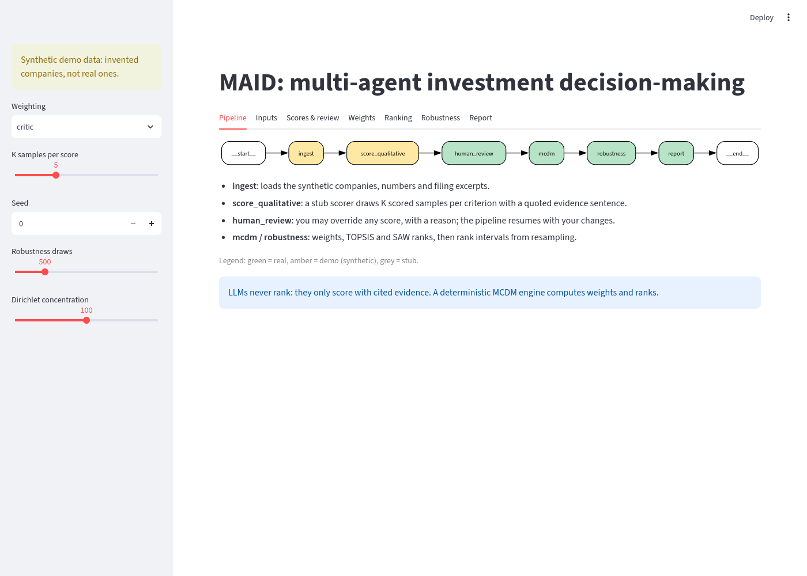
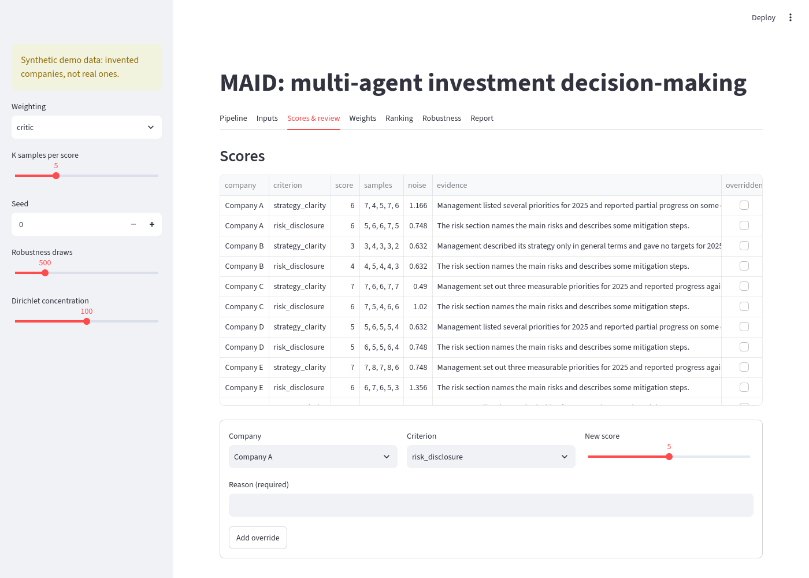
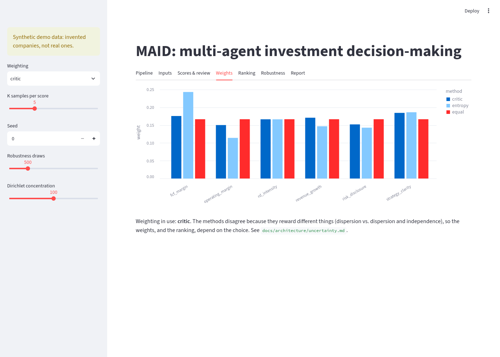
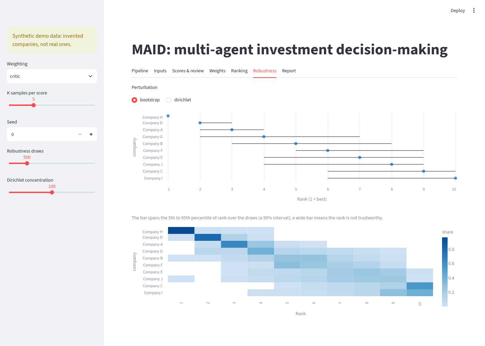

# Walkthrough: how to understand MAID in about two hours

A guided tour in reading order. Each stop names the file to open, what to look for, and one question to check
yourself. Nothing here is new: every statement points to a file. Paths are relative to this file.

| Stop | Topic | Minutes |
|---|---|---|
| 0 | Run it first | 10 |
| 1 | The question and the one rule | 10 |
| 2 | The architecture | 15 |
| 3 | The LangGraph pipeline | 20 |
| 4 | Where scores come from | 15 |
| 5 | The MCDM engine | 25 |
| 6 | Noise and robustness | 20 |
| 7 | How it is built and tested | 10 |
| 8 | Explaining it | 10 |

Total: 135 minutes. The data is synthetic (invented companies) and the scorer is a stub; see the status table in
[overview.md](architecture/overview.md) for what is real and what is planned.

## Stop 0 — Run it first (10 min)

Setup, from [README.md](../README.md):

```bash
python3 -m venv .venv && source .venv/bin/activate
pip install -e ".[dev]"
pytest
ruff check .
```

Run the whole pipeline on the synthetic dataset (no network, no API key):

```bash
python -m maid.demo
python -m maid.demo --weighting entropy --json out.json
```

It prints a Markdown report: ranking with TOPSIS and SAW scores, bootstrap, Dirichlet and score-noise 90% rank intervals,
weights, Kendall tau between TOPSIS and SAW, and human overrides ("none" unless you pass `--overrides`).
The flags are defined in `main()` in [demo.py](../src/maid/demo.py).

Then the GUI ([app/streamlit_app.py](../app/streamlit_app.py)):

```bash
pip install -e ".[gui]"
streamlit run app/streamlit_app.py
```

The sidebar sets weighting (entropy, critic, equal), K samples per score, seed, robustness draws and Dirichlet
concentration. One line per tab, using the tab names in the app:

- **Pipeline**: the graph drawn from the real compiled graph, nodes coloured real / demo / stub.
- **Inputs**: the decision matrix after overrides, and a synthetic filing excerpt per company.
- **Scores & review**: every LLM-style score with its K samples, noise and evidence quote; add an override
  (a reason is required) and watch the rest of the tabs change.
- **Weights**: entropy, CRITIC and equal weights side by side; the one in use is named under the chart.
- **Ranking**: TOPSIS and SAW ranks, Kendall tau between them, and a TOPSIS-vs-SAW rank scatter.
- **Robustness**: choose bootstrap, Dirichlet or score noise; bars are 90% rank intervals, the heat map is how often each
  company gets each rank.
- **Report**: the same Markdown report the CLI prints.



The **Pipeline** tab. Green nodes are real, amber are demo (synthetic data), grey are stubs.



The **Scores & review** tab: scores, the K samples behind each, noise and evidence.

Check: which pipeline nodes are drawn amber, and why? (Answer in `DEFAULT_STATUSES` in
[gui_data.py](../src/maid/gui_data.py): `ingest` and `score_qualitative`, because they use synthetic data and a stub scorer.)

## Stop 1 — The question and the one rule (10 min)

1. [SCOPE.md](SCOPE.md) sections 1 to 3: the research question (is a deterministic MCDM ranking stable, robust,
   informative?), the core principle, and the time frame (decision date 2025-03-31, anonymized company names).
2. [overview.md](architecture/overview.md) section 1, "The one idea to remember": the table of what LLM agents
   do versus what the MCDM engine does.
3. [decisions.md](architecture/decisions.md) D1, "LLMs score, MCDM ranks", with its alternatives and cost.

Look for: the same sentence ("LLMs never rank") in SCOPE section 2, in [CLAUDE.md](../CLAUDE.md) and in the last line
of the report built by `report()` in [graph.py](../src/maid/graph.py).

Check: what do you lose by reducing the LLM's judgment to 1-9 scores? (D1, "Cost".)

## Stop 2 — The architecture (15 min)

Open [overview.md](architecture/overview.md).

1. Read the status table first. It is the source of truth for what runs today; the diagrams below it show the
   target design.
2. "Diagram types used here" says how to read each kind:
   - C4 level 1 (system context): the system, its one human user and what it talks to.
   - C4 level 2 (containers): config, pipeline, MCDM engine, disk cache, checkpointer.
   - Flowchart (section 2): data flow through the pipeline. Section 3 draws the time boundary.
   - Sequence diagram (section 4): the order of calls in the human-in-the-loop step.
   - Decisions are lightweight ADRs in [decisions.md](architecture/decisions.md).
3. Section 5 is the evaluation plan; the backtest is not built.

Check: which external connections in the C4 diagrams exist today? (None; they are marked planned.)

## Stop 3 — The LangGraph pipeline (20 min)

1. Read [graph.md](architecture/graph.md): current graph, node/state table, interrupt and resume, checkpointer.
   The first diagram is checked against the code by `test_graph_doc_diagram_matches_code` in
   [test_docs.py](../tests/test_docs.py).
2. Open [state.py](../src/maid/state.py): `CriterionScore` (evidence mandatory), `ScoreOverride` (reason
   mandatory), `PipelineState` (all keys), `CHECKPOINT_TYPES`.
3. Open [graph.py](../src/maid/graph.py). `build_graph` (line 133) adds six nodes in a line. Trace one run and ask
   of each node which key it writes:
   - `ingest` writes `companies`, `quantitative`, `filings`, `criteria`, `settings`.
   - `score_qualitative` writes `qualitative`, `score_samples`, `score_noise`.
   - `human_review` (line 69) calls `interrupt(...)` and writes `overrides` after `parse_overrides` validates them.
   - `mcdm` writes `matrix`, `weights`, `scores`, `ranking`, `method_agreement`.
   - `robustness` writes `robustness`; `report` writes `report`.
4. Interrupt and resume: `run_demo` in [demo.py](../src/maid/demo.py) (line 11) invokes the graph, sees
   `__interrupt__` in the result, then invokes `Command(resume={"overrides": ...})` with the same `thread_id`
   and reads `graph.get_state(cfg).values`.
5. [test_review.py](../tests/test_review.py) shows the payload rules: no reason, score out of range, unknown
   company/criterion and non-dict payloads are rejected; `test_graph_records_overrides_after_resume` does the
   resume; `test_checkpoint_serde_restores_state_models` covers the msgpack allowlist.
6. The checkpointer is `MemorySaver` (last lines of `build_graph`): pause and resume work inside one process only.
7. The `Send` fan-out section of graph.md is a design that was dropped: agents run sequentially (D21).

Check: why does `human_review` need to be idempotent? (graph.md: on resume the node re-runs from its start.)

## Stop 4 — Where scores come from (15 min)

1. [demo_data.py](../src/maid/demo_data.py): `demo_dataset` builds 10 synthetic companies from a seed. Four
   quantitative criteria, two qualitative ones. Each company gets a hidden latent score per qualitative
   criterion, and its filing excerpt contains a template sentence that matches that score.
2. [scoring.py](../src/maid/scoring.py):
   - `StubScorer.score` returns K samples: latent score plus seeded noise, clipped to 1-9, with the template
     sentence as evidence.
   - `aggregate` takes the median and returns the sample standard deviation as noise.
   - `evidence_is_quoted` checks the evidence appears verbatim in the filing; `score_qualitative` in graph.py
     calls it for every score.
3. What the real scorer will replace: `StubScorer`, and the synthetic filings from `ingest`. The schema in
   state.py, the K-samples-then-aggregate shape and the evidence check are the parts meant to stay (see
   [uncertainty.md](architecture/uncertainty.md) on sampling noise and unsupported evidence). The real scorer (`llm.py`, a local model) is built but not yet wired into the graph.
4. Decisions: [decisions.md](architecture/decisions.md) D9 (integer 1-9 with evidence, K samples; K and the
   median-vs-mean rule are marked OPEN there) and D21 (local models only, sequential agents).
5. [cache.py](../src/maid/cache.py): `DiskCache.llm_key` makes model and prompt version part of the key (D7). No
   node uses the cache yet (overview status table).

Check: could a score with an invented quote pass? (No: `evidence_is_quoted` fails and the pipeline stops.)


## Stop 5 — The MCDM engine (25 min)

1. [mcdm.md](architecture/mcdm.md): weighting and ranking tables, why these choices, known limitations.
2. [weights.py](../src/maid/mcdm/weights.py): `equal_weights`, `entropy_weights` (`normalization="minmax"` by
   default, `"sum"` is the textbook variant), `critic_weights` (contrast x conflict). All take `X` with shape
   `(n_alternatives, m_criteria)` and assume every criterion is benefit-type.
3. [ranking.py](../src/maid/mcdm/ranking.py): `saw` (min-max normalized weighted sum) and `topsis` (vector
   normalization, closeness to ideal). Both validate the weight vector.
4. [matrix.py](../src/maid/matrix.py): `build_matrix` assembles `X` from quantitative values and qualitative
   scores (missing cell raises); `apply_overrides` returns new scores with the human reason appended to the
   evidence; `kendall_tau` compares two score vectors.
5. How they meet: the `mcdm` node in graph.py applies overrides, builds `X`, calls the chosen weight function,
   then `topsis` and `saw`. The ranking is by TOPSIS (`np.argsort(-t)`).
6. Decisions: D4 (data-driven weights, no AHP), D8 (SAW and TOPSIS; second family open), D10 (all benefit-type),
   D11 (normalization pairing; entropy variant open).
7. GUI: the **Weights** tab shows the three methods on the same matrix; the **Ranking** tab shows TOPSIS vs SAW
   and their Kendall tau. Try switching Weighting in the sidebar and adding an override in **Scores & review**.



Check: why does min-max entropy sometimes give one criterion most of the weight? (mcdm.md: a single outlier can
dominate; `test_minmax_entropy_rewards_single_outlier` in [test_mcdm.py](../tests/test_mcdm.py).)

## Stop 6 — Noise and robustness (20 min)

1. [uncertainty.md](architecture/uncertainty.md): the five-sentence argument, then the budget table (every noise
   source, where it enters, how measured, what is built).
2. Spike #6: [weight_stability.py](../scripts/weight_stability.py) simulates weight noise at small n; results in
   [weight-stability-results.md](research/weight-stability-results.md). Read "What the numbers say (and
   don't)" and "Limits": synthetic data, one generator, one seed.
3. [robustness.md](architecture/robustness.md) and [robustness.py](../src/maid/mcdm/robustness.py):
   - `bootstrap_weights` recomputes weights on resampled companies (estimation noise).
   - `dirichlet_weights` draws around the point weights (weight choice; `concentration` is a hand-set placeholder
     of 100).
   - `rank_intervals` ranks the original `X` under each draw and returns `RankIntervals`: point rank, median,
     5th/95th percentile `lo`/`hi`, and an acceptability matrix.
   - `score_noise_intervals` re-draws each LLM score from its K samples and ranks each perturbed `X` with weights recomputed (LLM score noise).
   - `robust_ranking` runs all three (score noise only when samples are passed) and returns them separately.
4. Decisions: D5 (intervals, not just a rank), D12 (Kendall tau primary), D13 (two separate weight perturbations), D16 (score noise).
5. GUI **Robustness** tab: change **Dirichlet concentration** in the sidebar and choose "dirichlet"; bars narrow
   as concentration grows and widen as it shrinks (`test_huge_concentration_collapses_interval` in
   [test_robustness.py](../tests/test_robustness.py) tests the extreme).



Check: why does the bootstrap understate uncertainty at about 12 companies? (robustness.md: it only resamples
companies already observed.)

## Stop 7 — How it is built and tested (10 min)

- [CLAUDE.md](../CLAUDE.md): the non-negotiable rules (LLMs never rank, decision date, MCDM engine is pure
  functions, cache everything, never commit `.env`) and conventions.
- Tests in [tests/](../tests/), one line each:
  - [test_mcdm.py](../tests/test_mcdm.py): weights sum to one, entropy/CRITIC behaviour, ranker and input validation.
  - [test_robustness.py](../tests/test_robustness.py): rank convention, Dirichlet/bootstrap draws, interval bounds, seeding.
  - [test_review.py](../tests/test_review.py): override validation, resume, checkpoint serialization.
  - [test_demo.py](../tests/test_demo.py): synthetic data, stub scorer, matrix helpers, end-to-end run, "LLMs never rank".
  - [test_gui_data.py](../tests/test_gui_data.py): the pure row/DOT helpers behind the GUI.
  - [test_gui_app.py](../tests/test_gui_app.py): the Streamlit app runs, and an override goes through the form.
  - [test_docs.py](../tests/test_docs.py): relative Markdown links resolve; graph.md diagram matches the code.
  - [test_config_cache.py](../tests/test_config_cache.py): settings read env at call time; cache robustness and key.
  - [test_scaffold.py](../tests/test_scaffold.py): cache computes once; graph pauses at `human_review` then finishes.
- CI: [ci.yml](../.github/workflows/ci.yml) runs `ruff check .` and `pytest -q` on Python 3.11 and 3.13.
- [plans/](../plans/README.md): numbered implementation plans that drove the work, with status and dependencies.

Check: where must the MCDM engine never do I/O or call an LLM? (CLAUDE.md rules; `src/maid/mcdm/` is pure functions.)

## Stop 8 — Explaining it (10 min)

Start from [INTERVIEW.md](INTERVIEW.md) (pitch, 11 questions) and use [decisions.md](architecture/decisions.md) for
the full arguments: each decision is written with alternatives, why and cost so it can be defended.

Try giving the one-minute version: the question (SCOPE section 1), the one rule (D1), what runs today (overview
status table), and the honest limits ([uncertainty.md](architecture/uncertainty.md) and the research
[README](research/README.md): notes were made from abstracts only).

## Map: concept → file

| Concept | Where in code | Where explained |
|---|---|---|
| Anonymized company names | `demo_dataset` in [demo_data.py](../src/maid/demo_data.py) ("Company A", ...) | [SCOPE.md](SCOPE.md) section 3; D3 |
| Decision date 2025-03-31 | `decision_date` (env `DECISION_DATE`) in [config.py](../src/maid/config.py) | SCOPE section 3; D3; overview section 3 |
| Evidence quote | `CriterionScore.evidence` in [state.py](../src/maid/state.py); `evidence_is_quoted` in [scoring.py](../src/maid/scoring.py) | [graph.md](architecture/graph.md); D9 |
| K samples | `StubScorer.score`, `aggregate` in scoring.py | D9; [uncertainty.md](architecture/uncertainty.md) |
| Human override | `parse_overrides`, `human_review` in [graph.py](../src/maid/graph.py); `apply_overrides` in [matrix.py](../src/maid/matrix.py) | graph.md "Human-in-the-loop" |
| Decision matrix X | `build_matrix` in matrix.py | [mcdm.md](architecture/mcdm.md); CLAUDE.md conventions |
| Entropy weights | `entropy_weights` in [weights.py](../src/maid/mcdm/weights.py) | mcdm.md; D4; D11 |
| CRITIC weights | `critic_weights` in weights.py | mcdm.md; D4 |
| SAW | `saw` in [ranking.py](../src/maid/mcdm/ranking.py) | mcdm.md; D8 |
| TOPSIS | `topsis` in ranking.py | mcdm.md; D8 |
| Kendall tau | `kendall_tau` in matrix.py | D12; [weight-stability-results.md](research/weight-stability-results.md) |
| Bootstrap | `bootstrap_weights` in [robustness.py](../src/maid/mcdm/robustness.py) | [robustness.md](architecture/robustness.md); D13 |
| Dirichlet perturbation | `dirichlet_weights` in robustness.py | robustness.md; D13 |
| Rank acceptability | `RankIntervals.acceptability` in robustness.py | robustness.md "How to read the output" |
| Checkpointer | `MemorySaver` in `build_graph`, `CHECKPOINT_TYPES` in state.py | graph.md "Checkpointer" |
| Cache key | `DiskCache.llm_key` in [cache.py](../src/maid/cache.py) | D7 |

## Check yourself

1. Why can't the scorer change the ranking? Scores go into `X`, and weights and ranks come from the pure-function
   MCDM engine; see D1 and [mcdm.md](architecture/mcdm.md).
2. What happens to a paused run if the process restarts? It is lost: `MemorySaver` is in-memory; see
   [graph.md](architecture/graph.md) "Checkpointer".
3. Why is a reason mandatory on every override? So disagreements can be analyzed later; see `ScoreOverride` in
   [state.py](../src/maid/state.py) and graph.md.
4. Why must all criteria be benefit-type? One code path and fewer sign bugs; see D10.
5. Why does the report give rank intervals and not just a rank? With about 12 alternatives and noisy weights a
   single rank overstates certainty; see D5.
6. Why are the bootstrap, Dirichlet and score-noise intervals reported separately? To show which kind of uncertainty drives a
   rank interval; see D13, D16 and [robustness.md](architecture/robustness.md).
7. Which weighting was less noisy at n=12 in spike #6, and what is the caveat? CRITIC (TV 0.056 vs 0.137 for
   min-max entropy, Gaussian regime), but synthetic data, one generator, one seed; see
   [weight-stability-results.md](research/weight-stability-results.md).
8. How do you know the claims in the research notes are reliable? You do not yet: they come from abstracts only, and
   UNVERIFIED items must be checked; see the research [README](research/README.md).
