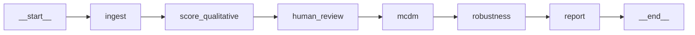
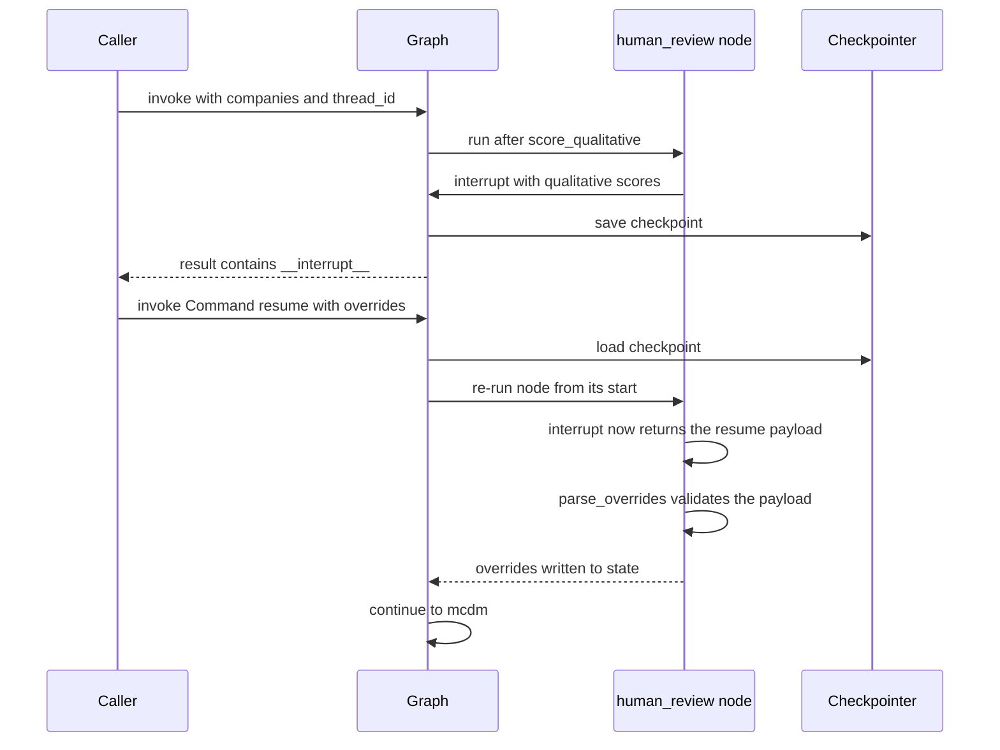
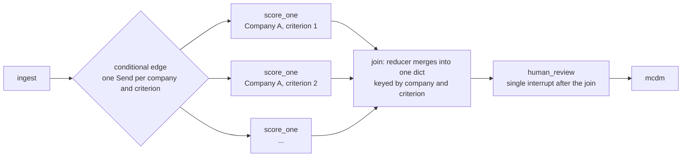

# Block: Pipeline orchestration (`src/maid/graph.py`, `src/maid/state.py`)

**Responsibility:** wire the pipeline steps together, carry shared state between them, pause for human
review, and resume afterwards.

## Current graph

<!-- current-graph: kept in sync with build_graph() by tests/test_docs.py -->

Linear; every node except `human_review` is a stub today (see the status table in [overview.md](overview.md)).

## Nodes and state

| Node | Reads | Writes | Status |
|---|---|---|---|
| `ingest` | `companies` | `quantitative` (empty dict) | stub |
| `score_qualitative` | `companies` | `qualitative` (empty list) | stub |
| `human_review` | `qualitative` | `overrides` | implemented (pauses, validates overrides) |
| `mcdm` | (nothing yet) | `weights`, `ranking` (empty) | stub |
| `robustness` | (nothing yet) | nothing | stub |
| `report` | (nothing yet) | `report` (empty string) | stub |

`PipelineState` keys (no key has a reducer, so each write replaces the key's value):

- `companies`: anonymized labels, e.g. "Company A".
- `quantitative`: company -> criterion -> value.
- `qualitative`: list of `CriterionScore`, the LLM scores.
- `overrides`: list of `ScoreOverride`, the human corrections.
- `weights`: criterion -> weight from the MCDM engine.
- `ranking`: companies ordered by the MCDM engine.
- `report`: final report text.

Two Pydantic models are stored in state:

- `CriterionScore` (company, criterion, score 1-9, `evidence`). `evidence` is mandatory: every LLM score must
  carry a quote from the source so it can be audited.
- `ScoreOverride` (company, criterion, score 1-9, `reason`). `reason` is mandatory (non-empty): every human
  override must be explainable, so disagreements can be analyzed later.

## Human-in-the-loop: interrupt and resume

- Resume payload: `Command(resume={"overrides": [{company, criterion, score, reason}, ...]})`. `{}` or `None`
  means no changes.
- `parse_overrides` validation: `None` becomes an empty list; a non-dict payload raises `ValueError`; each item is
  validated as a `ScoreOverride`; an override naming a (company, criterion) that is not in `qualitative` raises
  `ValueError`.
- The node must be idempotent: on resume it re-runs from its start, so anything before `interrupt()` runs twice.
- `CHECKPOINT_TYPES` exists because the checkpointer serializes state with msgpack, and LangGraph's
  `JsonPlusSerializer` only restores Pydantic classes listed in `allowed_msgpack_modules` (a strict allowlist).
  `CriterionScore` and `ScoreOverride` must be listed or a resumed run cannot rebuild them
  (exercised by `tests/test_review.py`).

## Checkpointer: MemorySaver today, persistent later

`MemorySaver` keeps checkpoints in process memory, keyed by `thread_id`. It gives pause and resume inside one
running process. It does not survive a restart: a paused run is lost if the process dies.

Planned: a persistent checkpointer such as SQLite, so a paused review can be resumed in a later process.
This is planned, not implemented.

## Target design: parallel scoring with Send

**Planned, not implemented.** Nothing in this section works today. Per `docs/research/llm-agents-finance.md`
(section 4, item 5), the design is:

- Parallel LLM calls: `Send` objects from a conditional edge give map-reduce fan-out, and the destinations run
  in the same superstep (in parallel), per the research note.
- Each branch can be cached and retried independently.
- A reducer is needed: each state key has its own reducer, and parallel writes to one list key need one such as
  `Annotated[list, operator.add]` (the research note marks this exact snippet UNVERIFIED).
- The interrupt sits after the join so the human reviews all scores once. Interrupts inside parallel branches
  are not documented in what the research read, so they are avoided.
- The review node stays idempotent and the checkpointer becomes persistent.

## Why LangGraph (and not plain functions)

Decision D6 in [decisions.md](decisions.md): LangGraph was chosen over plain Python functions because built-in
checkpointing and `interrupt` give human-in-the-loop cheaply, and the graph mirrors the architecture diagram.
The cost is a framework dependency for a mostly linear pipeline.

Honest counterpoint: for today's linear pipeline, plain functions would be simpler. LangGraph pays off with the
interrupt, the checkpointing and the planned fan-out.

## Known limitations

- `MemorySaver` only: a restart loses a paused run.
- Overrides are validated but not applied to scores yet.
- No fan-out: scoring is a single stub node.
- All nodes except `human_review` are stubs.
