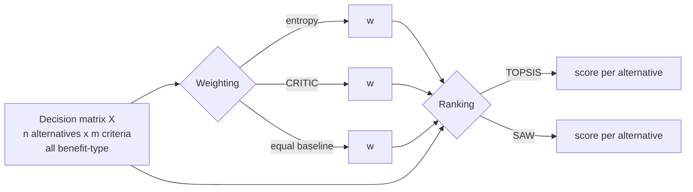

# Block: MCDM engine (`src/maid/mcdm/`)

**Responsibility:** turn a decision matrix (alternatives x criteria) into criterion weights and a
ranking. Pure functions, no LLM, no I/O. Everything is unit tested.

## Weighting methods

| Method | Idea | Strength | Weakness (seen or known) |
|---|---|---|---|
| Entropy | More "informative" (less evenly spread) criteria get more weight | Simple, uses only the data | With min-max pre-normalization (current default) a single outlier can dominate (test `test_minmax_entropy_rewards_single_outlier`); the textbook sum-normalized variant (`normalization="sum"`, positive data only) does not do this. min-max variant: noisier than CRITIC at n=12 in our simulation |
| CRITIC | Weight = spread x (1 - correlation with other criteria) | Down-weights redundant criteria (tested) | Uses Pearson correlation, outlier-sensitive; did not improve with n under skew in our simulation |
| Equal | 1/m each | No estimation noise; honest baseline | Ignores that criteria differ in importance |

## Ranking methods

| Method | Idea | Trade-off |
|---|---|---|
| SAW | Weighted sum of min-max normalized values | Transparent and easy to explain; was the more stable ranker under weight noise in our simulation; fully compensatory |
| TOPSIS | Closeness to ideal and anti-ideal point | Considers distance to both extremes; sensitive to normalization and, in our simulation, to weight noise |

## Why these choices
- **Data-driven weights only** (no human pairwise comparison/AHP): keeps the first version simple and
  removes my own judgment from the weights. Cost: no expert input, and weights inherit data noise.
- **Both entropy and CRITIC, plus equal-weight baseline:** no single weighting method is known to be
  best here; disagreement between them is itself a robustness signal.
- **Two rankers:** one simple and one distance-based, so a conclusion that holds under both is more credible.
- Not implemented yet: VIKOR / PROMETHEE II (planned second ranker family), cost-type criteria.

## Evidence
See [weight-stability-results.md](../research/weight-stability-results.md) (synthetic simulation) and
[mcdm-noise.md](../research/mcdm-noise.md) (desk research, abstracts only).

## Known limitations
All criteria must already be benefit-type. Min-max normalization depends on sample extremes, so a
company added or removed can change weights and ranks.
Default entropy variant is not yet decided (min-max vs sum); see spike #6 results.
