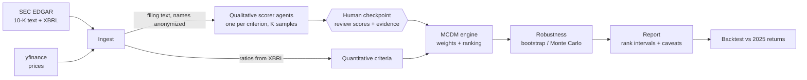
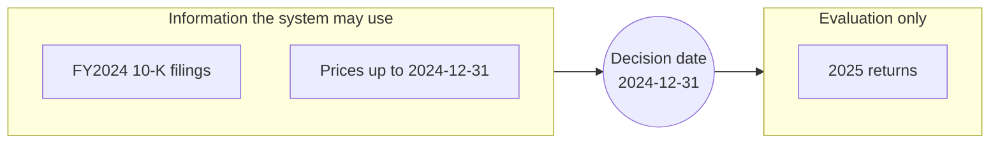
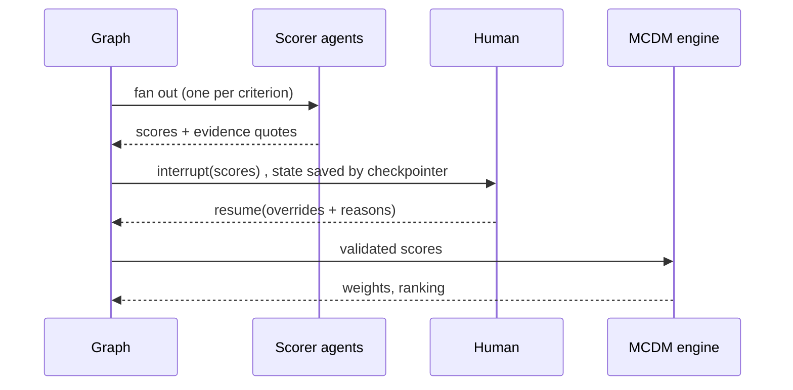
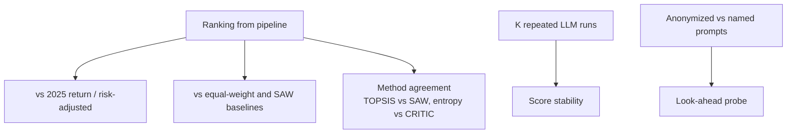

# Architecture overview

Goal: rank companies on mixed quantitative and qualitative criteria **without letting an LLM make the
ranking decision**. Diagrams are Mermaid and render on GitHub. Per-block detail lives in the other
files in this folder; the reasoning behind each choice is in [decisions.md](decisions.md).

## 1. The one idea to remember
LLMs are good at reading text and bad at being auditable decision makers. MCDM methods are the opposite.
So each does only what it is good at:

| Does | LLM agents | MCDM engine |
|---|---|---|
| Reads filings, extracts evidence | yes | no |
| Converts text to a 1-9 score | yes | no |
| Computes weights | no | yes (entropy, CRITIC) |
| Ranks companies | no | yes (TOPSIS, SAW) |
| Reproducible given the same inputs | no (sampled) | yes |

## 2. System flow

Quantitative criteria bypass the LLM entirely: numbers come from XBRL, which removes a whole class of
hallucination risk. Only genuinely textual criteria (e.g. strategy quality, risk disclosure) use agents.

## 3. Time boundary (look-ahead control)

The pipeline never sees the right-hand side; it is used once, afterwards, to grade the ranking.
Known leak: the LLM itself may have been trained on later text. See decisions D3.

## 4. Human-in-the-loop (LangGraph interrupt)

The interrupt sits after the join, not inside parallel branches, so the human reviews everything once
and the checkpointer can resume across restarts. Overrides are logged with a reason; they can later be
used to measure where the LLM disagrees with the human.

## 5. Evaluation

With about 12 companies the backtest is noisy; the project reports correlations and intervals, not
"accuracy".

## Blocks
- [mcdm.md](mcdm.md): weights and ranking (implemented)
- Ingest, scorer agents, human checkpoint, robustness, report: documented as each is built
