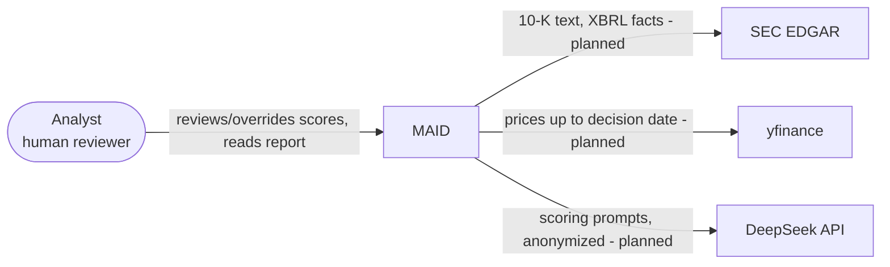
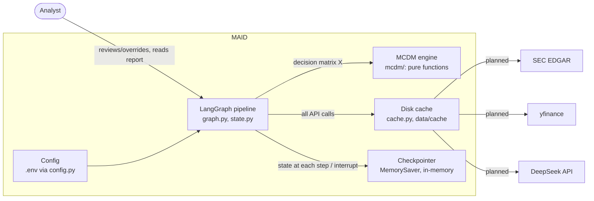
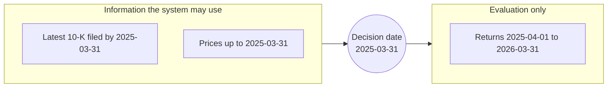
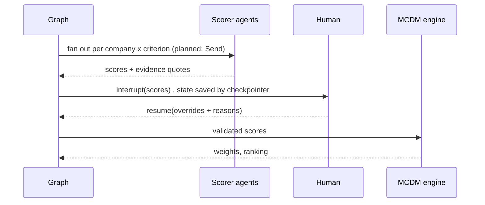

# Architecture overview

Goal: rank companies on mixed quantitative and qualitative criteria **without letting an LLM make the
ranking decision**. Diagrams are Mermaid and render on GitHub. Per-block detail lives in the other
files in this folder; the reasoning behind each choice is in [decisions.md](decisions.md).

## Status: what is built today

| Block | Code | Status |
|---|---|---|
| Ingest (SEC EDGAR, yfinance) | `graph.py` `ingest()` loads the `demo_data.py` synthetic dataset | demo implemented (synthetic dataset); real SEC/yfinance ingest planned; spec: [data.md](data.md) |
| Disk cache | `cache.py` `DiskCache` (sha256 keys; `llm_key(model, prompt_version, ...)`) | implemented, not yet used by any node |
| Config | `config.py` `Settings`: `DEEPSEEK_API_KEY`, `DEEPSEEK_BASE_URL`, `DEEPSEEK_MODEL` (default `deepseek-flash`), `DECISION_DATE` (default 2025-03-31), `MAID_CACHE_DIR` (default `data/cache`) | implemented |
| Qualitative scorer agents | `graph.py` `score_qualitative()` uses `scoring.py` `StubScorer`; schema `CriterionScore` in `state.py` (score int 1-9 + evidence quote) | stub scorer implemented (deterministic, K samples, evidence check); DeepSeek scorer planned |
| Human checkpoint | `graph.py` `human_review()` calls `interrupt(...)`; `parse_overrides()` validates the resume payload (`ScoreOverride`, reason mandatory, unknown company/criterion rejected) | implemented; overrides applied in `mcdm` |
| MCDM engine | `mcdm/weights.py`, `mcdm/ranking.py` (entropy, CRITIC, equal; TOPSIS, SAW) | implemented and wired (node `mcdm`) |
| Robustness | `mcdm/robustness.py` (bootstrap, Dirichlet and score-noise rank intervals) | implemented and wired |
| Report | `graph.py` `report()` builds a Markdown report from state | implemented (Markdown) |
| Backtest (2025-04 to 2026-03) | none | planned |
| Checkpointer | `build_graph()` compiles with `MemorySaver` (in-process memory) | implemented; does NOT survive a process restart |

Diagrams in sections 2-4 show the target design; the table above is the source of truth for what runs today.

### Diagram types used here
- C4 model, level 1 (System context) and level 2 (Containers): what the system is and what it talks to.
- Flowchart (data flow): how data moves through the pipeline.
- Sequence diagram: the order of calls in the human-in-the-loop step.
- Design decisions are written as lightweight ADRs (Architecture Decision Records) in `decisions.md`.

## 0. System context and containers (C4)

Level 1, system context:



MAID is one system with one human user. It reads public filings and prices and sends only anonymized
prompts to the LLM provider. The external connections are planned; today ingest loads a synthetic demo dataset and scoring uses a stub scorer.

Level 2, containers:



The pipeline orchestrates the steps, hands the decision matrix to the pure-function MCDM engine, and
routes every external call through the disk cache. The cache is not yet used by any node and the
checkpointer does not survive a restart (see the status table).

## 1. The one idea to remember
LLMs are good at reading text and bad at being auditable decision makers. MCDM methods are the opposite.
So each does only what it is good at:

| Does | LLM agents | MCDM engine |
|---|---|---|
| Reads filings, extracts evidence | yes | no |
| Converts text to a 1-9 score | yes | no |
| Computes weights | no | yes (entropy, CRITIC) |
| Ranks companies | no | yes (TOPSIS, SAW) |
| Reproducible given the same inputs | no (sampled) | yes |

## 2. System flow

```mermaid
flowchart LR
    A[SEC EDGAR<br/>10-K text + XBRL] --> I[Ingest]
    B[yfinance<br/>prices] --> I
    I -->|ratios from XBRL| Q[Quantitative criteria]
    I -->|filing text, names anonymized| S["Qualitative scorer agents<br/>one per company x criterion, K samples (stub today)"]
    S --> H{{Human checkpoint<br/>review scores + evidence}}
    H --> M[MCDM engine<br/>weights + ranking]
    Q --> M
    M --> R[Robustness<br/>bootstrap / Monte Carlo]
    R --> O[Report<br/>rank intervals + caveats]
    O --> E[Backtest (2025-04 to 2026-03)]
```

Quantitative criteria bypass the LLM entirely: numbers come from XBRL, which removes a whole class of
hallucination risk. Only genuinely textual criteria (e.g. strategy quality, risk disclosure) use agents.

## 3. Time boundary (look-ahead control)



The pipeline never sees the right-hand side; it is used once, afterwards, to grade the ranking.
Known leak: the LLM itself may have been trained on later text. See decisions D3.

## 4. Human-in-the-loop (LangGraph interrupt)



The interrupt sits after the join, not inside parallel branches, so the human reviews everything once.
Today the graph uses `MemorySaver`, which keeps checkpoints in process memory: a paused run survives
within one Python process, but a restart loses it. Resuming across restarts needs a persistent
checkpointer (e.g. SQLite) and is planned. Today the graph is linear (no fan-out yet). Overrides are
validated with a mandatory reason and applied to the scores in the mcdm node before the decision matrix is built.

## 5. Evaluation

```mermaid
flowchart TB
    R[Ranking from pipeline] --> B1[vs evaluation-window return (2025-04 to 2026-03) / risk-adjusted]
    R --> B2[vs equal-weight and SAW baselines]
    R --> B3[Method agreement<br/>TOPSIS vs SAW, entropy vs CRITIC]
    S[K repeated LLM runs] --> B4[Score stability]
    N[Anonymized vs named prompts] --> B5[Look-ahead probe]
```

With about 12 companies the backtest is noisy; the project reports correlations and intervals, not
"accuracy".

## Blocks
- [graph.md](graph.md): LangGraph pipeline, state, interrupt/resume (skeleton implemented, ingest and scoring are stubs; mcdm and robustness nodes are real)
- [mcdm.md](mcdm.md): weights and ranking (implemented)
- [robustness.md](robustness.md): rank intervals via bootstrap and weight perturbation (implemented and wired into the graph)
- [data.md](data.md): real-data spec: sources, point-in-time 10-K rule, universe, quantitative criteria (planned)
- [uncertainty.md](uncertainty.md): every noise source, how it is measured, what is built
- Ingest, scorer agents, human checkpoint, report: documented as each is built
