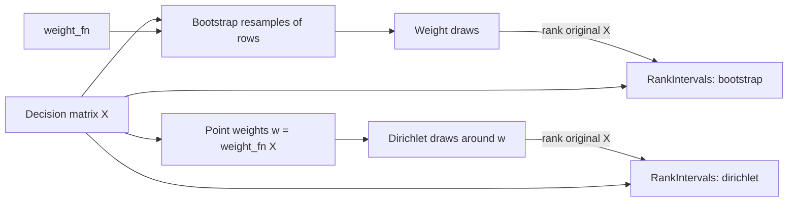

# Block: Robustness (`src/maid/mcdm/robustness.py`)

**Responsibility:** report rank intervals and rank acceptability instead of point ranks, under two
separate sources of weight uncertainty. Pure numpy, no LLM, no I/O. Library only: not yet wired into
the graph's `robustness` node.

## The two sources

| Source | Uncertainty it represents | Parameter | Caveat |
|---|---|---|---|
| Bootstrap | Weight-estimation noise: "what if we had observed a slightly different set of companies" | `n_draws` | With n around 12 it understates uncertainty, because it only resamples companies already observed |
| Dirichlet | Weight-choice uncertainty around the point weights (`E[w'] = w`, `Var(w'_j) = w_j(1-w_j)/(concentration+1)`) | `n_draws`, `concentration` (placeholder 100) | Spread is set by hand; zero weights are floored to 1e-6 |

The two are reported separately, not mixed. In both, the original `X` is what gets ranked.

## How to read the output
- Ranks: 1 = best; ties share the better rank.
- `lo`-`hi` is a 90% rank interval (5th to 95th percentile, always ranks that actually occurred).
- `acceptability[i, 0]` is the share of draws in which alternative `i` is ranked first;
  `acceptability[i, r-1]` is the share where it gets rank `r`.
- `point` is the rank under the point weights. Arrays are indexed by row order of `X`.

## Open questions
- Calibrate `concentration`: pick it so Dirichlet weight spread matches the bootstrap spread observed on the real matrix (or the spike's TV at n=12), instead of the placeholder 100.
- Should the report combine both sources (e.g. Dirichlet around each bootstrap draw), or show them side by side?
- Report format: rank intervals per company plus rank-1 acceptability; decide the threshold under which two companies are called "not distinguishable".

## Known limitations
Tests are synthetic only. Min-max-based rankers make ranks depend on sample extremes. Nothing here
addresses LLM score noise (that comes from the K repeated runs).
