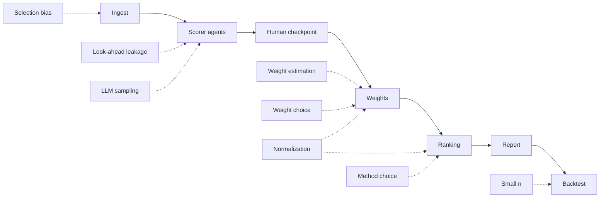

# Uncertainty budget: where noise enters and what we do about it

One page that names every source of noise in MAID, where it enters the pipeline, how it is measured or reduced, and whether that is built.

## The argument in five sentences

1. The universe is about 12 companies ([SCOPE](../SCOPE.md) section 4).
2. LLM scores are sampled, the weights are estimated from those 12 rows, and several method choices (weighting, normalization, ranker) are defensible.
3. Spike #6 shows weight noise alone moves rankings: Kendall tau between sample-weight and reference-weight rankings is roughly 0.62 to 0.89 at n=12 ([results](../research/weight-stability-results.md); synthetic data only).
4. So the system reports rank intervals and method agreement, never a single leaderboard ([decisions.md](decisions.md) D5, [robustness.md](robustness.md)).
5. The backtest is a sanity check, not proof: with n=12 a Spearman correlation needs |rho| above about 0.58 to reach p<0.05 ([mcdm-noise.md](../research/mcdm-noise.md) section 2, item 7; abstract-only note, threshold checked with the t-approximation). At n=15 the threshold is about 0.51.

Caveat: the research notes were made from abstracts only (see [research README](../research/README.md)); claims marked abstract-only below should be verified before being relied on.

## Where noise enters

## The budget

| Source | What it is | Where | How measured / reduced | Status | Source doc |
|---|---|---|---|---|---|
| LLM sampling noise | Same prompt gives different scores at nonzero temperature | Scorer agents | Repeat K times, aggregate by median or mean, store variance; stability = score variance across K runs. K and the rule are open | demo: stub scorer draws K samples, median aggregate, std stored in score_noise; real LLM scorer planned; built: score-noise rank intervals in the robustness node (bootstrap of the median of K; overrides held fixed; D16) | [SCOPE](../SCOPE.md) sections 5.3 and 6; [llm-agents-finance](../research/llm-agents-finance.md) section 4 (abstract-only) |
| LLM error / unsupported evidence | Score not backed by the filing | Scorer agents, human checkpoint | Every score carries a cited evidence quote; reject scores whose quote is not a substring of the filing text; human reviews and can override with a reason | demo: substring check on every score, human checkpoint, overrides applied with reason; real LLM scorer planned | [llm-agents-finance](../research/llm-agents-finance.md) section 4 (abstract-only); [overview](overview.md) |
| Look-ahead leakage | The model may know post-2025-03-31 text; the DeepSeek cutoff is unpublished and likely later | Scorer agents | Decision date 2025-03-31 and anonymized company names; anonymization is necessary but insufficient; look-ahead probe (anonymized vs named prompts) | documented only (probe not built) | [SCOPE](../SCOPE.md) section 3; [decisions.md](decisions.md) D3; [llm-agents-finance](../research/llm-agents-finance.md) section 4 (abstract-only) |
| Selection bias | Universe is the N largest by market cap: mild survivorship and winner bias | Ingest | Documented, not fixed | documented only | [SCOPE](../SCOPE.md) section 4 |
| Weight estimation noise | Data-driven weights come from about 12 rows | Weights | Spike #6 simulation; bootstrap rank intervals | built: bootstrap rank intervals in the robustness graph node | [results](../research/weight-stability-results.md); [robustness.md](robustness.md) |
| Weight choice | Entropy, CRITIC and equal weights are all defensible | Weights | Dirichlet perturbation around the point weights; `concentration` is a placeholder 100, uncalibrated | built: Dirichlet rank intervals in the robustness graph node; concentration uncalibrated | [robustness.md](robustness.md); [mcdm.md](mcdm.md) |
| Normalization choice | Min-max normalization depends on sample extremes, so adding or removing a company can change weights and ranks; default entropy variant (min-max vs sum) undecided | Weights and ranking | Spike #6 compares min-max and sum entropy (log-normal only); no mitigation yet | documented only | [mcdm.md](mcdm.md); [results](../research/weight-stability-results.md) |
| Method choice (weighting x ranker) | Entropy vs CRITIC, TOPSIS vs SAW can disagree | Weights and ranking | Method-agreement report (TOPSIS vs SAW, entropy vs CRITIC) | built: Kendall tau TOPSIS vs SAW in the mcdm node and report; entropy vs CRITIC comparison planned | [mcdm.md](mcdm.md); [overview](overview.md) section 5; [mcdm-noise.md](../research/mcdm-noise.md) item 8 (abstract-only) |
| Small-n backtest | Correlation with evaluation-window returns over about 12 companies is weak evidence | Backtest | Report correlation, not accuracy; Kendall tau primary for ranking comparison; absolute rho must exceed about 0.58 at n=12 | planned (backtest not built) | [SCOPE](../SCOPE.md) section 6; [mcdm-noise.md](../research/mcdm-noise.md) item 7 (abstract-only) |

## Key numbers

All spike #6 numbers are from synthetic data only (seed 42, m=7 criteria, 300 trials, Gaussian regime, n=12). Reference weights are the same estimator on a big sample, not a ground truth; one generator, one seed ([results](../research/weight-stability-results.md)).

| Quantity | Value | Source |
|---|---|---|
| Entropy weights TV vs reference | 0.137 | [results](../research/weight-stability-results.md) |
| CRITIC weights TV vs reference | 0.056 | [results](../research/weight-stability-results.md) |
| Kendall tau, entropy to TOPSIS | 0.622 | [results](../research/weight-stability-results.md) |
| Kendall tau, entropy to SAW | 0.777 | [results](../research/weight-stability-results.md) |
| Kendall tau, CRITIC to TOPSIS | 0.738 | [results](../research/weight-stability-results.md) |
| Kendall tau, CRITIC to SAW | 0.886 | [results](../research/weight-stability-results.md) |
| Spearman threshold at n=12 for p<0.05, two-sided | about 0.58 (t-approximation gives 0.576; abstract-only note) | [mcdm-noise.md](../research/mcdm-noise.md) section 2, item 7 |

Also from the spike: SAW rankings were more stable than TOPSIS under the same weight noise; under skew (log-normal) CRITIC stops improving with n (TV about 0.09 from n=8 to n=200).

## Why intervals and agreement, not a better single method

- No method is known to be best at n=12; do not conclude "method X is best" from one sector-year ([mcdm-noise.md](../research/mcdm-noise.md) item 8, abstract-only).
- Disagreement between methods is itself information: [mcdm.md](mcdm.md) "Why these choices" calls it "a robustness signal".
- Ranks in the middle are least reliable: the ranking method matters much less at the top and bottom than in the middle, where scores are tied within noise ([mcdm-noise.md](../research/mcdm-noise.md), abstract-only).
- The bootstrap understates uncertainty with n around 12 because it only resamples companies already observed ([robustness.md](robustness.md)).
- The Dirichlet spread is set by hand (`concentration` placeholder 100), so its width is not evidence by itself ([robustness.md](robustness.md)).
- Score-noise intervals with small K understate the spread, and K=1 gives zero width ([robustness.md](robustness.md), D16).

## Open questions

- Calibrate `concentration` (see [robustness.md](robustness.md)).
- Choose K and the aggregation rule for LLM samples.
- Decide how to combine the noise sources in the report (side by side or nested).
- Decide the threshold for calling two companies "not distinguishable".
